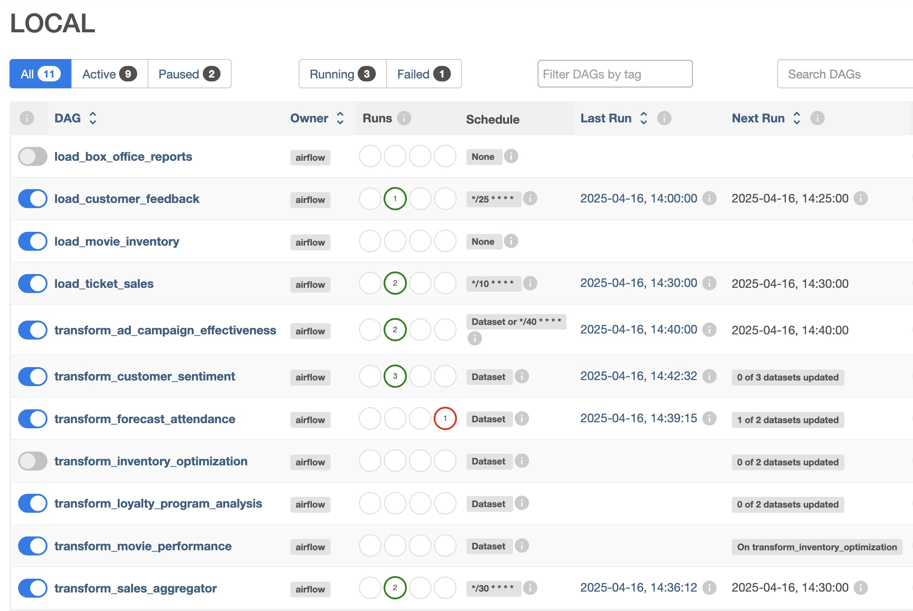

# ⚠️ REPOSITORY MOVED - NO LONGER MAINTAINED HERE

**This repository has been transferred to new ownership and is no longer actively maintained in this location.**

## 🔄 Migration Notice

This repository and all associated open-source packages have been moved to a new GitHub organization.

**New Location:** https://github.com/ponderedw

## 📍 What This Means

- ✅ **Active development** continues at the new location
- ✅ **Latest updates** and releases are published there
- ✅ **Issues and pull requests** should be submitted to the new repository
- ⚠️ **This repository** will no longer receive updates

## 🔗 Find the Updated Repository

Please visit https://github.com/ponderedw to:
- Access the latest version of this package
- Report issues or contribute
- View updated documentation
- Get support from the maintainers

---

**Thank you for your understanding during this transition.**

# Airflow MCP

This project implements an MCP server for Apache Airflow, enabling users to interact with their orchestration platform using natural language.

With a few minutes of setup, you should be able to use Claude Desktop or any MCP-enabled LLM to ask questions like:
- "What DAGs do we have in our Airflow cluster?"
- "What is our latest failed DAG?"

And more!

## About MCP and Airflow MCP

The Model Context Protocol (MCP) is an open standard creating secure connections between data sources and AI applications. This repository provides a custom MCP server for Apache Airflow that transforms how teams interact with their orchestration platform through natural language.

## 🚀 Features

- Query pipeline statuses through natural language
- Troubleshoot DAG failures efficiently
- Retrieve comprehensive DAG information
- Trigger DAGs based on their status
- Monitor execution results
- Analyze DAG components and configurations

## 🛠️ Getting Started

### Prerequisites

If you already have an Airflow instance and want to use our prebuilt Docker image, you only need:
- Docker
- Access to your Apache Airflow instance
- LLM access (Claude, ChatGPT, or AWS Bedrock)

This repository also provides a local setup for Apache Airflow, which you can use for demo purposes.

You can also build the MCP server from source, detailed below.

### Quick Start - Using the Prebuilt Docker Image

If you have an Airflow instance and want to use our prebuilt Docker image, simply follow these steps:


You'll need to configure Claude Desktop to connect to your Airflow instance. If you haven't configured Claude Desktop for use with MCP before, we recommend following the [Claude Desktop documentation](https://modelcontextprotocol.io/quickstart/user).

Here are the steps to configure Claude Desktop to connect to your Airflow instance, using our prebuilt Docker image:

- Open Claude Desktop
- Go to Settings → Developer tab
- Edit the MCP config with:
```json
{
   "mcpServers": {
         "airflow_mcp": {
            "command": "docker",
            "args": ["run", "-i", "--rm", "-e", "airflow_api_url", "-e", "airflow", "-e", "airflow", "hipposysai/airflow-mcp:latest"],
            "env": {
               "airflow_api_url": "http://host.docker.internal:8088/api/v1",
               "airflow_username": "airflow",
               "airflow_password": "airflow"
            }
         }
   }
}
```


### Running MCP Locally with Claude Desktop

1. Clone this repository:
   ```
   git clone https://github.com/hipposys-ltd/airflow-mcp
   ```

2. If you don't have a running Airflow environment, start one with:
   ```
   just airflow
   ```

   This will start an Airflow instance on port 8088, with username `airflow` and password `airflow`.

   You can access Airflow at http://localhost:8088/ and see multiple DAGs configured:

   .

   These DAGs have complex dependencies, some running on a schedule and some using Airflow's Dataset functionality.

3. Configure Claude Desktop:

   You'll need to configure Claude Desktop to connect to your Airflow instance. If you haven't configured Claude Desktop for use with MCP before, we recommend following the [Claude Desktop documentation](https://modelcontextprotocol.io/quickstart/user).

   Here are the steps to configure Claude Desktop to connect to your Airflow instance:

   - Open Claude Desktop
   - Go to Settings → Developer tab
   - Edit the MCP config with:
   ```json
   {
      "mcpServers": {
          "airflow_mcp": {
              "command": "docker",
              "args": ["run", "-i", "--rm", "-e", "airflow_api_url", "-e", "airflow", "-e", "airflow", "hipposysai/airflow-mcp:latest"],
              "env": {
                "airflow_api_url": "http://host.docker.internal:8088/api/v1",
                "airflow_username": "airflow",
                "airflow_password": "airflow"
              }
          }
      }
   }
   ```

4. Test your setup by asking Claude: "What DAGs do we have in our Airflow cluster?"

### Integrating with LangChain

1. Set up environment:
   ```
   cp template.env .env
   ```

2. Configure your LLM model in `.env`:
   - For AWS Bedrock: `LLM_MODEL_ID=bedrock:...`
   - For Anthropic: `LLM_MODEL_ID=anthropic:...`
   - For OpenAI: `LLM_MODEL_ID=openai:...`

3. Add your API credentials to `.env`:
   - AWS credentials for Bedrock
   - `ANTHROPIC_API_KEY` for Claude
   - `OPENAI_API_KEY` for ChatGPT

4. (Optional) Connect to your own Airflow:
   ```
   airflow_api_url=your_airflow_api_url
   airflow_username=your_airflow_username
   airflow_password=your_airflow_password
   ```

5. Start the project:
   - With bundled Airflow: `just project`
   - With existing Airflow: `just project_no_airflow`

6. Open web interfaces:
   ```
   just open_web_tabs
   ```

7. Try it out by asking "How many DAGs failed today?" in the Chat UI

## 📝 Example Usage

- "What DAGs do we have in our Airflow cluster?"
- "Identify all DAGs with failed status in their most recent execution and trigger a new run for each one"
- "What operators are used by the transform_forecast_attendance DAG?"
- "Has the transform_forecast_attendance DAG ever completed successfully?"

## Running MCP with LangChain

You can use `from langchain_mcp_adapters.client import MultiServerMCPClient` in order to add our Airflow MCP as one of your tools in your LangChain app.

### Option 1: Separate Container (SSE Transport)

If you run our Airflow MCP as a separate container, use SSE transport:

```python
mcp_host = os.environ.get('mcp_host', 'mcp_sse_server:8000')
mcps = {
    "AirflowMCP": {
        "url": f"http://{mcp_host}/sse",
        "transport": "sse",
        "headers": {"Authorization": f"""Bearer {
            os.environ.get('MCP_TOKEN')}"""}
    }
}
```

### Option 2: Embedded Server (STDIO Transport)

If you want to run our MCP server as part of the LangChain code, without any outside code, use STDIO and make sure you install our library first (`airflow-mcp-hipposys = "0.1.0a11"`):

```python
mcps = {
    "AirflowMCP":
    {
        'command': "python",
        'args': ["-m", "airflow_mcp_hipposys.mcp_airflow"],
        "transport": "stdio",
        'env': {k: v for k, v in {
            'AIRFLOW_ASSISTENT_AI_CONN': os.getenv(
                'AIRFLOW_ASSISTENT_AI_CONN'),
            'airflow_api_url': os.getenv('airflow_api_url'),
            'airflow_username': os.getenv('airflow_username'),
            'airflow_password': os.getenv('airflow_password'),
            'AIRFLOW_INSIGHTS_MODE':
                os.getenv('AIRFLOW_INSIGHTS_MODE'),
            'POST_MODE': os.getenv('POST_MODE'),
            'TRANSPORT_TYPE': 'stdio',
            '_AIRFLOW_WWW_USER_USERNAME':
                os.getenv('_AIRFLOW_WWW_USER_USERNAME'),
            '_AIRFLOW_WWW_USER_PASSWORD':
                os.getenv('_AIRFLOW_WWW_USER_PASSWORD')
        }.items() if v is not None}
    }
}
```

### Using the Tools

Then in both cases, pass it to the tools:

```python
client = MultiServerMCPClient(mcps)
tools = await client.get_tools()
```

## 🤝 Contributing

We enthusiastically invite the community to contribute to this open-source initiative! Whether you're interested in:

- Adding new features
- Improving documentation
- Enhancing compatibility with different LLM providers
- Reporting bugs
- Suggesting improvements

Please feel free to submit pull requests or open issues on our GitHub repository.

## 🔗 Links

- [GitHub Repository](https://github.com/hipposys-ltd/airflow-mcp)
- [Docker Repository](https://hub.docker.com/repository/docker/hipposysai/airflow-mcp/general)
---
